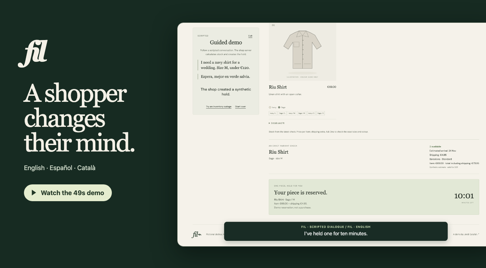
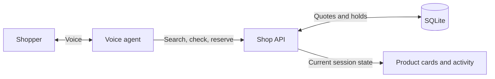

# Fil

Fil is a voice shopping assistant for a fictional clothing shop. Shoppers can change their mind or switch languages mid-conversation and keep the preferences they already gave.

[](https://catafal.github.io/fil-shop-assistant/)

[Watch the 49-second demo](https://catafal.github.io/fil-shop-assistant/) · [Download the MP4](docs/media/fil-guided-demo.mp4?raw=true) · [Run locally](#run-locally)

The clip uses scripted dialogue in English, Spanish, and Catalan. The actual shop server calculates the quote, creates the hold, and handles the retry.

## A shopper changes their mind

> “I need a navy shirt for a wedding. Size M, under €120.”
>
> “Espera, mejor en verde salvia.”

The shortlist changes to sage green and keeps the size, occasion, and budget. The shopper then asks in Catalan about delivery to Barcelona. Fil checks the exact variant, shows the item price and shipping separately, and places a ten-minute hold when the shopper asks for one.

The catalogue, delivery estimates, and holds are synthetic.

## How it works



- **A quote follows the current request.** A change to the search or delivery choice invalidates the previous quote.
- **A hold is one transaction.** The agent interprets spoken consent. The server checks the quote, session ownership, expiry, and stock before it creates the hold. An exact retry returns the same reservation.
- **The page reflects actual outcomes.** The activity panel shows tool calls and errors. The guided demo uses isolated stock so anyone can try it without credentials or a microphone.

[Architecture and tool contracts](docs/architecture.md)

## Run locally

Install Python 3.12, [uv](https://docs.astral.sh/uv/getting-started/installation/), and Node.js 24. Clone this repository and run the commands from its root.

```sh
make install
make build
make demo
```

Open [Fil on localhost](http://127.0.0.1:8000) and select **Try the guided demo**. Try a hold, a refusal, or the inventory outage. Run `make check` for the Python and browser-code checks.

## Project notes

- [Case study](docs/case-study.md) explains how a passing simulation missed an invented delivery deadline.
- [Evaluation guide](docs/evaluation-v2.md) describes the local, provider, and voice checks.
- [Live voice setup](docs/voice-setup.md) explains how to connect an agent.
- [MIT license](LICENSE) and [audio credits](docs/media/credits.md).
